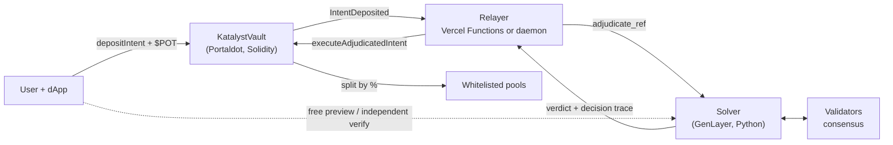

# Katalyst — cross-chain intent settlement for Portaldot

**GenLayer decides, Portaldot settles — and you can verify every decision yourself.**

A user states an intent in plain language ("max yield, A-Tier carbon only"). GenLayer validators read it, apply guardrails
and agree on a route; the Portaldot vault re-validates that route on-chain and only then moves funds. Built for the
Portaldot Hacker House — **Multi-Chain & Cross-Chain Infra** track (a cross-chain decision layer), with Ecosystem-DApp
metrics.



## Live on testnet

| | |
| --- | --- |
| Vault (Portaldot V3 Testnet, chain 420420777) | `0x74fcFD25f70fcB562e09930D92d39d6B4cCFCc71` |
| Solver (GenLayer Studionet) | `0x8cE92023E3052C428876139a2Ca8F666179eBf2B` |
| Exercised | approved settlements (single pool and 57/43 splits), a prompt-injection rejection with refund, both via the always-on and the serverless relayer, plus a second settlement chain |

## Features

**Decisions you can inspect**
- **Decision trace.** Every verdict says what was understood from the prompt and why each pool was kept or excluded.
- **Free preview.** Simulate the full adjudication before depositing (`preview_intent`): nothing stored, nothing at stake.
- **Real consensus data.** Validator votes and GenLayer / Portaldot transaction links, read from GenLayer's own records.

**Verification and trust**
- **Verify any settlement** (`#/verify/N`, `katalyst verify N`): rebuilds the story from on-chain events and GenLayer's
  records and checks that the deposit, the prompt GenLayer judged, the verdict, and what was paid all agree; exports a
  proof bundle.
- **Shareable impact receipts** (`#/receipt/N`) with image export.
- **Defence in depth against prompt injection:** static screen → constrained model → deterministic allocation → on-chain
  re-validation. The **Security lab** fires attacks at the live solver.
- **Commitment-bound settlement:** the relayer cannot change who is paid, how much, or the prompt. See
  [docs/THREAT_MODEL.md](docs/THREAT_MODEL.md) (including what is *not* guaranteed).

**v2 contracts (built and tested, not yet deployed)** — permissionless refunds after a timeout, pause / two-step ownership / relayer
rotation, an immutable fee and deposit cap, an opt-in route lock, real withdrawable pool positions (`PoolHub`), and an optimistic
settlement delay with owner veto. See [docs/V2_DESIGN.md](docs/V2_DESIGN.md).

**Infrastructure**
- **Runs entirely on Vercel:** the relayer ships as Vercel Functions driven by the dApp; an always-on Docker relayer is
  available for unattended settlement. See [DEPLOY.md](DEPLOY.md).
- **Multi-chain:** one solver, several settlement chains (`ref = chainId:vault:nonce`). Tested end to end on a second chain.
- **SDK, CLI, embeddable widget** and a second example consumer. See [docs/INTEGRATION.md](docs/INTEGRATION.md).
- **Operations:** `/api/status` (503 when unhealthy, stuck-intent detection), Prometheus `/api/metrics`, webhook / Telegram
  notifications, a GitHub Actions uptime check, and a validator-reliability view. See [docs/OBSERVABILITY.md](docs/OBSERVABILITY.md).
- **Cost-aware design:** one storage slot per pending intent, because Portaldot charges per byte
  (≈315 tPOT to deploy vs ≈1,001 for the ink! variant); the chain's storage-deposit refund is forwarded back to the user.

## Layout

```
contracts/evm       KatalystVault.sol — the vault (Solidity, EVM RPC)             ← primary
contracts/vault     ink! 4.3 variant — builds, but ~1,000 tPOT to deploy; kept for reference
genlayer/           solver (intelligent_vault_solver.py), example consumer, unit tests
relayer/            always-on relayer (optional), deploy / test / fuzz scripts (Node ≥ 20)
frontend/           dApp (src/), SDK (src/sdk/), widget (src/widget/), serverless relayer (api/)
cli/                `katalyst` command line
docs/               architecture, threat model, observability, integration, 90-second demo script
```

## Run it

```bash
# 1. Contract + checks
cd relayer && cp .env.example .env && npm install
npm run compile:evm          # solc -> contracts/evm/build/KatalystVault.json
npm run test:evm             # 11 scenario tests on an in-process EVM
npm run fuzz:evm             # randomised invariant test (conservation, replay, access control)
npm run test:solver          # 31 solver + example unit tests (Python)
npm run fund:info            # prints each EVM key's mapped native account — send tPOT THERE
npm run estimate:evm         # balance + gas/deposit estimate, sends nothing
npm run deploy:evm           # deploy; writes VAULT_CONTRACT_ADDRESS into .env
npm run compile:v2 && npm run test:v2 && npm run fuzz:v2   # v2 contracts: 11 scenario tests + randomised invariants
npm run estimate:v2          # real-chain cost estimate for v2 (sends nothing)

# 2. GenLayer solver (Studionet is gasless)
node scripts/deploy_genlayer.mjs

# 3. dApp (serverless relayer included)
cd ../frontend && cp .env.example .env && npm install && npm run dev
```

1. **Funding.** EVM keys hold $POT in a *mapped native account* (`fund:info` prints it). Send tPOT to that `5…` address,
   **not** the `0x…` one. Testnet tokens come from the Portaldot team (no public faucet).
2. **Settlement.** Either deploy to Vercel ([DEPLOY.md](DEPLOY.md)) or run the always-on relayer: `cd relayer && npm start`.
3. **Check an intent yourself:** `npm --prefix frontend run cli -- verify <n>`.

CI (`.github/workflows/`, enabled once the repo token has the `workflow` scope): frontend build, relayer typecheck,
Solidity tests + fuzz, solver tests, Slither, and an uptime check.

## Honest limitations

- **Unaudited testnet software.** The vault cannot verify GenLayer's result on-chain, so it trusts the relayer to relay the
  verdict faithfully; deviations are *detectable* (Verify) but not prevented. A relayer quorum, `refundExpired`, pause and
  multisig ownership are planned for a v2 contract.
- **Demo pools** are generated addresses, not yield strategies; funds sent to them are not invested.
- Oracle endpoints in the solver are placeholders; on failure it uses an embedded APY/eco table (feeds can only change APY and
  tier of *known* pools, never addresses).
- `owner` and `relayer` are `immutable` (no storage deposit): rotating them means redeploying.
- In serverless mode settlement advances only while a page is polling (see [DEPLOY.md](DEPLOY.md) for the limits and the
  always-on alternative).
- The public RPC prunes old transactions (it keeps logs), so verification falls back to events and says so.

## License

[MIT](LICENSE)
