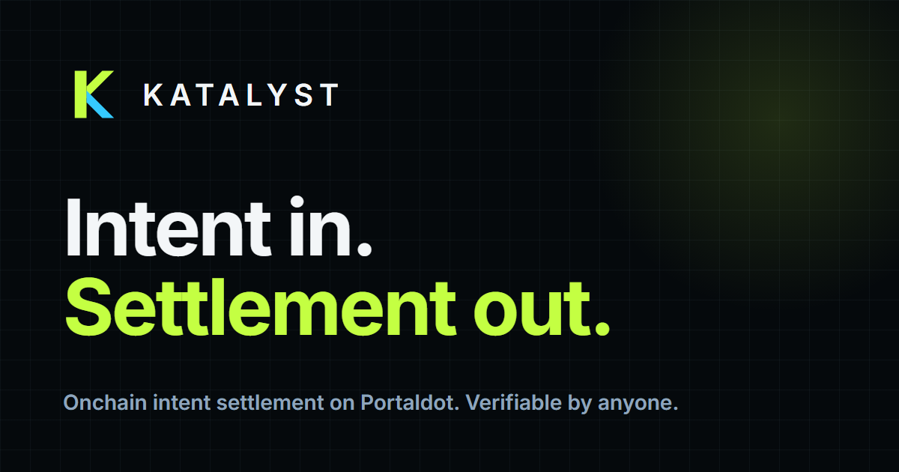
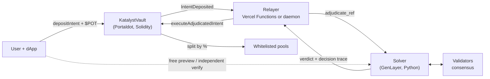

<p align="center"></p>

# Katalyst — cross-chain intent settlement for Portaldot

**GenLayer decides, Portaldot settles — and you can verify every decision yourself.**

A user states an intent in plain language ("max yield, A-Tier carbon only"). GenLayer validators read it, apply guardrails
and agree on a route; the Portaldot vault re-validates that route on-chain and only then moves funds. Built for the
Portaldot Hacker House — **Multi-Chain & Cross-Chain Infra** track (a cross-chain decision layer), with Ecosystem-DApp
metrics.



## Live on testnet

| | |
| --- | --- |
| **Vault v2** (Portaldot V3 Testnet, chain 420420777) | `0x786DEF20A47b7B22c67eBaac3A9a3b3D5C0ddD46` |
| PoolHub (v2 pool positions) | `0xE987E541075b404c2376c9d94A517A2A9Af0997E` |
| Vault v1 (kept for history, selectable in the app) | `0x74fcFD25f70fcB562e09930D92d39d6B4cCFCc71` |
| Solver (GenLayer Studionet) | `0x8cE92023E3052C428876139a2Ca8F666179eBf2B` |
| Exercised (v1) | approved settlements (single pool and 57/43 splits), a prompt-injection rejection with refund, both via the always-on and the serverless relayer, plus a second settlement chain |
| Exercised (v2) | route-locked and unlocked settlements through the serverless relayer and the safety delay, a **rogue relayer proposal caught by the guardian and vetoed with a full refund**, depositor cancel, pool withdrawal, every one independently verified (`katalyst verify`) |

## Features

**Decisions you can inspect**
- **Decision trace.** Every verdict says what was understood from the prompt and why each pool was kept or excluded.
- **Free preview.** Simulate the full adjudication before depositing (`preview_intent`): nothing stored, nothing at stake.
- **Real consensus data.** Validator votes and GenLayer / Portaldot transaction links, read from GenLayer's own records.

**Verification and trust**
- **Verify any settlement** (`#/verify/N`, `katalyst verify N`): rebuilds the story from on-chain events and GenLayer's
  records and checks that the deposit, the prompt GenLayer judged, the verdict, and what was paid all agree; exports a
  proof bundle.
- **Shareable impact receipts** (`#/receipt/N`) with image export.
- **Defence in depth against prompt injection:** static screen → constrained model → deterministic allocation → on-chain
  re-validation. The **Security lab** fires attacks at the live solver.
- **Commitment-bound settlement:** the relayer cannot change who is paid, how much, or the prompt. See
  [docs/THREAT_MODEL.md](docs/THREAT_MODEL.md) (including what is *not* guaranteed).

**v2 contracts (live)** — permissionless refunds after a timeout, pause / two-step ownership / relayer rotation, an immutable
fee and deposit cap, an opt-in **route lock** ("what you preview is what you get"), real withdrawable pool positions
(`PoolHub`), and an **optimistic settlement delay with owner veto** plus a **guardian** that vetoes any proposal that differs from
what the validators agreed. See [docs/V2_DESIGN.md](docs/V2_DESIGN.md).

**Infrastructure**
- **Runs entirely on Vercel:** the relayer ships as Vercel Functions driven by the dApp; an always-on Docker relayer is
  available for unattended settlement. See [DEPLOY.md](DEPLOY.md).
- **Multi-chain:** one solver, several settlement chains (`ref = chainId:vault:nonce`). Tested end to end on a second chain.
- **SDK, CLI, embeddable widget** and a second example consumer. See [docs/INTEGRATION.md](docs/INTEGRATION.md).
- **Operations:** `/api/status` (503 when unhealthy, stuck-intent detection), Prometheus `/api/metrics`, webhook / Telegram
  notifications, a GitHub Actions uptime check, and a validator-reliability view. See [docs/OBSERVABILITY.md](docs/OBSERVABILITY.md).
- **Cost-aware design:** one storage slot per pending intent, because Portaldot charges per byte
  (≈315 tPOT to deploy vs ≈1,001 for the ink! variant); the chain's storage-deposit refund is forwarded back to the user.

## Layout

```
contracts/evm       KatalystVault.sol (v1) and v2/ (KatalystVaultV2.sol + PoolHub.sol)   ← primary
contracts/vault     ink! 4.3 variant — builds, but ~1,000 tPOT to deploy; kept for reference
genlayer/           solver (intelligent_vault_solver.py), example consumer, unit tests
relayer/            always-on relayer (optional), deploy / test / fuzz scripts, guardian (Node ≥ 20)
frontend/           dApp (src/), SDK (src/sdk/), widget (src/widget/), serverless relayer (api/)
cli/                `katalyst` command line
docs/               architecture, threat model, observability, integration, 90-second demo script
```

## Run it

```bash
# 1. Contract + checks
cd relayer && cp .env.example .env && npm install
npm run compile:evm          # solc -> contracts/evm/build/KatalystVault.json
npm run test:evm             # 11 scenario tests on an in-process EVM
npm run fuzz:evm             # randomised invariant test (conservation, replay, access control)
npm run test:solver          # 31 solver + example unit tests (Python)
npm run fund:info            # prints each EVM key's mapped native account — send tPOT THERE
npm run estimate:evm         # balance + gas/deposit estimate, sends nothing
npm run deploy:evm           # deploy v1; writes VAULT_CONTRACT_ADDRESS into .env
npm run compile:v2 && npm run test:v2 && npm run fuzz:v2   # v2 contracts: 11 scenario tests + randomised invariants
npm run estimate:v2          # real-chain cost estimate for v2 (sends nothing)
npm run deploy:v2            # deploy PoolHub + vault v2 (dry run without --send)
npm run guardian             # watch v2 proposals; add -- --veto to cancel any that differ from the validators' verdict

# 2. GenLayer solver (Studionet is gasless)
node scripts/deploy_genlayer.mjs

# 3. dApp (serverless relayer included)
cd ../frontend && cp .env.example .env && npm install && npm run dev
```

1. **Funding.** EVM keys hold $POT in a *mapped native account* (`fund:info` prints it). Send tPOT to that `5…` address,
   **not** the `0x…` one. Testnet tokens come from the Portaldot team (no public faucet).
2. **Settlement.** Either deploy to Vercel ([DEPLOY.md](DEPLOY.md)) or run the always-on relayer: `cd relayer && npm start`.
3. **Check an intent yourself:** `npm --prefix frontend run cli -- verify <n>`.

CI (`.github/workflows/`, enabled once the repo token has the `workflow` scope): frontend build, relayer typecheck,
Solidity tests + fuzz, solver tests, Slither, and an uptime check.

## Roadmap: the next 2–3 months to mainnet

What we plan to build between now and a mainnet launch. It is a plan, not a promise: mainnet depends on Portaldot's mainnet
being available to deploy on, and on the audit finding nothing that needs a redesign. Each item targets a limitation listed
under [Honest limitations](#honest-limitations) or in the [threat model](docs/THREAT_MODEL.md).

### Month 1: harden what exists

- [ ] **Multisig owner and timelock.** Move vault ownership from a single key to a multisig, with a timelock on relayer rotation and pool registration.
- [ ] **Always-on settlement.** A keeper that advances intents without a browser polling them (scheduled functions or the always-on relayer in `relayer/`), so a closed tab never delays a settlement.
- [ ] **Guardian as a service.** Run the delay-window guardian continuously with alerting, and publish its status on the Network page.
- [ ] **Multi-RPC reads.** Cross-check events against more than one Portaldot RPC provider and fail loudly on disagreement, removing the single-RPC trust point.
- [ ] **Indexer for history.** Replace per-page log scans with a small indexer, so the Activity and Recent settlements views show exact timestamps and full history, independent of RPC pruning.
- [ ] **Audit preparation.** Freeze the v2 contract scope, expand the invariant and fuzz suite, add static analysis and gas reports to CI, and write the audit brief.

### Month 2: remove single points of trust

- [ ] **External security audit** of `KatalystVaultV2` and `PoolHub`, with fixes and a published report.
- [ ] **Relayer quorum.** k-of-n signed attestations from independent operators, so no single relayer key can propose a route. Needs onboarding of at least two more operators first.
- [ ] **Real pool strategies behind `PoolHub`.** Replace the demo pool addresses with strategy adapters that hold and invest funds, with per-pool caps and an emergency withdraw path.
- [ ] **Live data for the solver.** Replace the placeholder yield and eco-score endpoints with real, source-attributed feeds, with staleness limits and a signed snapshot that validators agree on.
- [ ] **Bug bounty** on the audited contracts, with a public scope and severity table.

### Month 3: launch

- [ ] **Mainnet deployment** with conservative limits (low deposit cap, allow-listed pools), raised in steps as the audit and monitoring history allow.
- [ ] **More settlement chains.** Extend the multi-chain support that already works on a second EVM chain to additional chains, one solver and several vaults.
- [ ] **Standing orders.** Recurring or conditional intents ("rebalance weekly into A-Tier pools") with an explicit authorisation model.
- [ ] **Operator and user monitoring.** Prometheus and webhook alerts, a public status page, and per-wallet notifications for settlement, veto and refund events.
- [ ] **Docs and SDK stabilisation.** Versioned SDK and CLI, an integration guide for third-party dApps, and migration notes from the testnet vaults.

### Later, not committed

Gasless first deposits (blocked today because $POT is native currency), account-abstraction wallets, and an on-chain light-client or proof
of GenLayer results, which would remove the remaining trust in the relayer entirely.

## Honest limitations

- **Unaudited testnet software.** The vault cannot verify GenLayer's result on-chain, so it trusts the relayer to relay the
  verdict faithfully. v2 bounds that trust: a proposed route waits out a delay during which the owner (or the guardian script)
  can veto it, and the depositor can lock the route. A relayer *quorum* is the next step once there are independent operators.
  The veto relies on someone watching during the delay, and the owner is a single key (multisig / timelock planned).
- **Demo pools** are generated addresses, not yield strategies; funds sent to them are not invested.
- Oracle endpoints in the solver are placeholders; on failure it uses an embedded APY/eco table (feeds can only change APY and
  tier of *known* pools, never addresses).
- v1 has `immutable` owner and relayer (rotating them means redeploying). v2 can rotate the relayer and transfer ownership, but
  its fee, cap, timeout and delay are immutable by design.
- In serverless mode settlement advances only while a page is polling (see [DEPLOY.md](DEPLOY.md) for the limits and the
  always-on alternative).
- The public RPC prunes old transactions (it keeps logs), so verification falls back to events and says so.

## License

[MIT](LICENSE)
