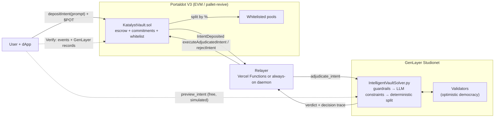
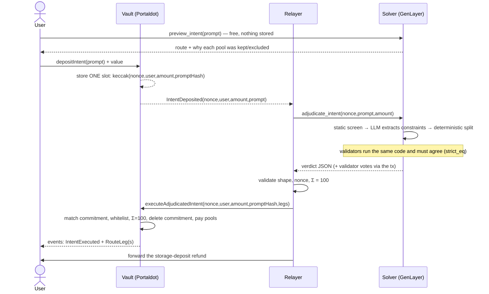

# Architecture

Katalyst is a **cross-chain decision layer**: GenLayer (where contracts can read language and reason about it) decides;
Portaldot (where the money is) settles. The two chains never talk directly, so a thin relayer carries the verdict across and
the vault re-validates it.

## Components



## One intent, end to end



## v2: safety delay, veto and pool positions (current testnet vault)

```mermaid
sequenceDiagram
  autonumber
  actor U as User
  participant V as KatalystVaultV2 (Portaldot)
  participant R as Relayer (Vercel Functions)
  participant G as GenLayer solver
  participant H as PoolHub (Portaldot)
  participant W as Guardian + owner

  U->>V: depositIntent(prompt, routeLock?) + tPOT
  Note over V: stores ONE commitment hash (user, amount, prompt, lock, deadline)
  R->>G: adjudicate(prompt)
  G-->>R: route agreed by validator consensus
  R->>V: executeAdjudicatedIntent(route)
  Note over V: validates totals, lock; records a PROPOSAL (delay 60 s)
  W->>G: re-derive the verdict
  alt proposal differs from the verdict
    W->>V: vetoSettlement (owner)
    V-->>U: full refund
  else matches, delay over
    R->>V: finalizeSettlement (anyone may)
    V->>H: depositFor(pool, user) per leg, minus the fixed fee
    H-->>U: withdrawable position per pool
  end
  Note over U,V: the depositor can cancel any time; after the timeout anyone can refundExpired
```

What the v2 contract adds over v1, and why:

- **Settlement delay with veto** bounds a compromised or buggy relayer: it can no longer move money instantly, and a watcher has a window to stop a route that does not match the validators' verdict.
- **Route lock** (opt-in) binds the deposit to the route the user previewed: the vault pays exactly that route or nothing.
- **Permissionless refund after a timeout** means a relayer outage can never strand funds, and the depositor needs no gas for it.
- **PoolHub** keeps a per-user, per-pool position that the user can withdraw at any time, even while the vault is paused.
- **Pause, two-step ownership, relayer rotation, immutable fee and cap** for operations and incident response.

Details and the deployment record are in [V2_DESIGN.md](V2_DESIGN.md); the guarantees and residual risks are in [THREAT_MODEL.md](THREAT_MODEL.md).

## Design decisions (and why)

**The model never chooses addresses or percentages.** It only extracts constraints (tier, minimum APY, max-yield,
"is this malicious?"). Allocation is plain Python over an embedded whitelist, which also makes validators' outputs
identical so `gl.eq_principle.strict_eq` converges. The constraints are merged with an independent regex parse and the
**stricter** wins.

**One storage slot per pending intent.** Portaldot charges a storage deposit (0.06 tPOT/byte, 0.15/item). The prompt, the
route and the status therefore live in **events**, and a pending intent is a single commitment hash that is deleted on
settlement. Measured deployment cost: ≈315 tPOT (vs ≈1,001 for the ink! variant).

**The relayer is stateless where possible.** Everything needed to resume is on-chain (vault commitment) or idempotent
(`adjudicate_intent` returns the stored verdict for a nonce already seen). That is what lets the relayer run as Vercel
Functions driven by the dApp's polling, or as an always-on daemon, with the same logic.

**Verification is evidence-based.** `katalyst verify <n>` and the Verify page rebuild the story from persistent event logs
and GenLayer's transaction records, because the public RPC prunes old transactions but keeps logs.

**Storage-refund pass-through.** The chain refunds a freed storage slot's deposit to whoever freed it (the relayer). The
relayer forwards it to the depositor, cutting a user's overhead from ≈7.7 to ≈0.3 tPOT per intent (v1). In v2 the freed deposits are used by the settlement itself to create the user's hub-position slots, which the user recovers when they withdraw; see [V2_DESIGN.md](V2_DESIGN.md).

## Repository map

| Path | What |
| --- | --- |
| `contracts/evm/` | `KatalystVault.sol` (v1) and `v2/` (`KatalystVaultV2.sol`, `PoolHub.sol`), both deployed on the testnet |
| `contracts/vault/` | ink! 4.3 variant (reference; costlier to deploy) |
| `genlayer/` | Intelligent contract + unit tests |
| `relayer/` | Always-on relayer, deploy/test/fuzz scripts, guardian |
| `frontend/` | landing page and dApp (`src/`), SDK (`src/sdk/`), serverless relayer and RPC proxy (`api/`) |
| `cli/` | `katalyst` command line |
| `docs/` | This folder |
